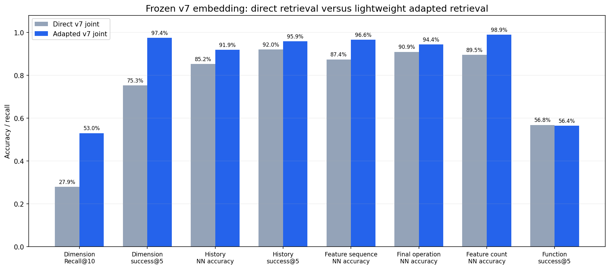
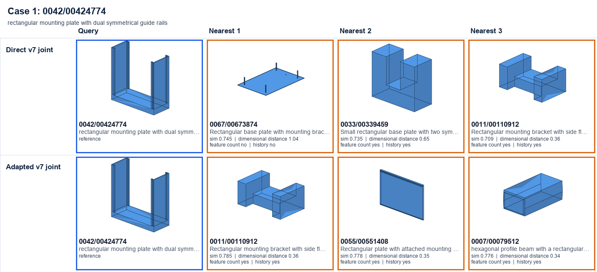
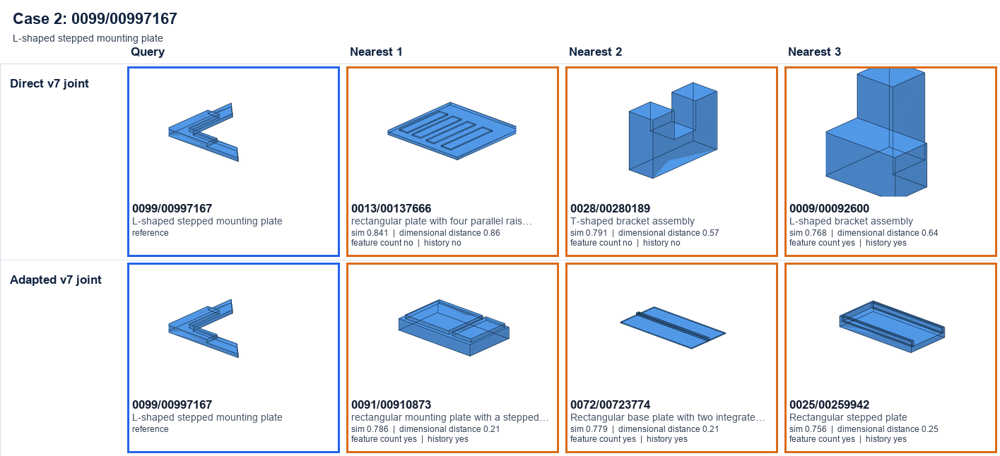
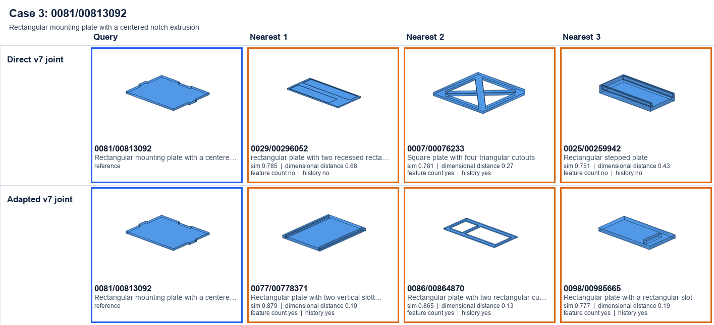
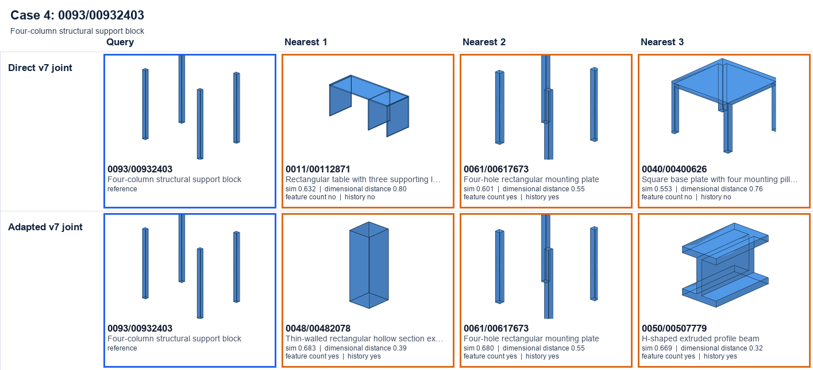
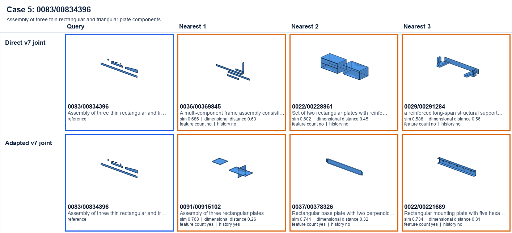
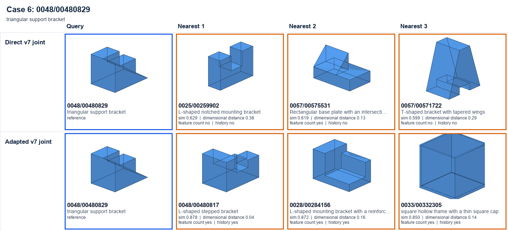

# Lightweight downstream retrieval adapter for HistCAD v7

## Result

The experiment tests whether the frozen v7 joint representation contains information that can be organized more effectively by a small task-specific retrieval model. Positive table deltas mean that adaptation helped; negative deltas expose specialization tradeoffs.

## Direct versus adapted test retrieval

| Metric | Direct pretrained embedding | With downstream adapter | Change |
|---|---:|---:|---:|
| Dimensional Recall@10 | 27.9% | 53.0% | +25.1 pp |
| Dimensional success@5 | 75.3% | 97.4% | +22.2 pp |
| Dimensional MAE@1 | 0.254 | 0.169 | -33.6% |
| Operation-history NN accuracy | 85.2% | 91.9% | +6.7 pp |
| Operation-history success@5 | 92.0% | 95.9% | +3.9 pp |
| Feature-sequence NN accuracy | 87.4% | 96.6% | +9.2 pp |
| Final-operation NN accuracy | 90.9% | 94.4% | +3.5 pp |
| Feature-count NN accuracy | 89.5% | 98.9% | +9.4 pp |
| Primitive-profile NN accuracy | 70.7% | 63.3% | -7.5 pp |
| Dominant-constraint NN accuracy | 96.5% | 95.9% | -0.6 pp |
| Canonical-function NN accuracy | 31.3% | 31.4% | +0.1 pp |
| Canonical-function success@5 | 56.8% | 56.4% | -0.4 pp |

Near-tie queries changed from 1,721 to 1,678; the median top-1/top-2 margin changed from 0.0191 to 0.0184.

## What was trained

The original v7 encoder and `best.pt` weights were frozen. The adapter has 4,664,351 trainable parameters and keeps the output at 4096 dimensions. It contains one chunk-level multi-head attention block, attention pooling, a small residual MLP, and lightweight auxiliary heads.

Adapter supervision used:

- approximate dimensional/structural positive pairs from the 22-D target vector;
- contrastive retrieval against fixed negative samples;
- dimensional-summary regression;
- feature-count and final-Boolean-operation classification; and
- a small residual-anchor loss to retain the original representation.

Functional labels and text were not used for adapter training. Exact operation history, feature sequence, primitive profile, constraints, and functional labels were evaluation targets only. Changes in exact history and feature-sequence retrieval therefore measure transfer from the supervised dimensional/coarse-structural adaptation.

## Protocol

Training used 145,915 training parts. Checkpoint selection used 8,130 validation parts and selected epoch 14 at validation loss 0.050689. The adapter trainer accessed zero test samples. The final direct and adapted embeddings were then evaluated once on the unchanged 8,086-part test split using the same self-match removal, cosine similarity, dimensional reference neighbors, labels, and metrics as the previous benchmark.

Because feature count, final operation, and dimensional targets are used to train the adapter, their gains are task-adapted results—not zero-shot representation metrics. The encoder remains frozen, so the experiment specifically measures how much task-relevant information can be recovered from the pretrained latent vector.

## Qualitative retrieval

Six comparison sheets contain 97 unique, successfully rendered STEP parts; 82 displayed parts failed validation. Each sheet uses the same query and shows direct and adapted top-3 results. Captions report dimensional distance, feature-count agreement, and exact operation-history agreement.

### Retrieval case 1

### Retrieval case 2

### Retrieval case 3

### Retrieval case 4

### Retrieval case 5

### Retrieval case 6

## Interpretation

Direct retrieval measures general-purpose latent organization, while the adapted results measure task-specific extractability. No single adapted metric should replace the direct benchmark: direct retrieval measures general-purpose latent organization, while adapted retrieval measures task-specific extractability. Both should be reported.

## Artifacts

- `best_adapter.pt`: validation-selected adapter checkpoint
- `adapted_representations.pt`: UID-aligned direct and adapted embeddings
- `training_summary.json`: complete training and validation history
- `evaluation.json`: complete validation/test metrics and deltas
- `comparison.csv`: compact direct-versus-adapted table
- `qualitative_manifest.csv`: identities and correctness for all displayed retrievals
- `render_audit.json`: CAD import and rendering checks
- `retrieval_sheets/INDEX.md`: qualitative gallery
