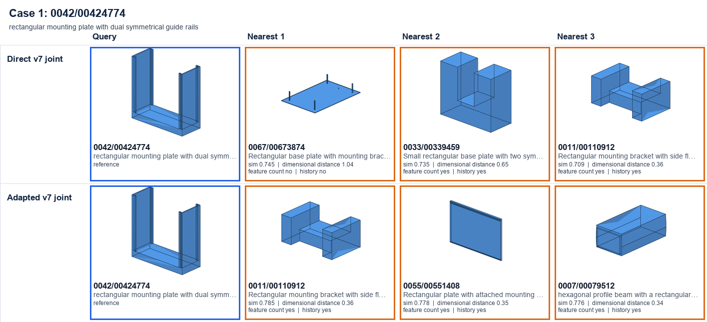
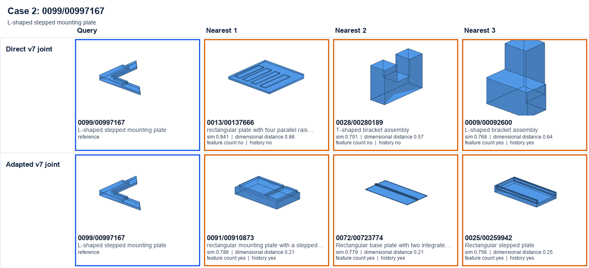
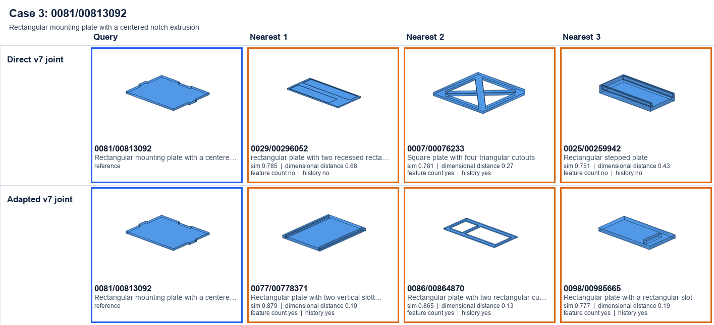
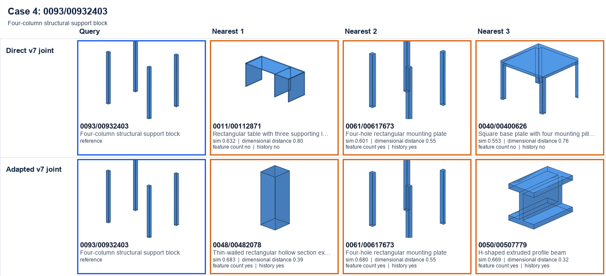
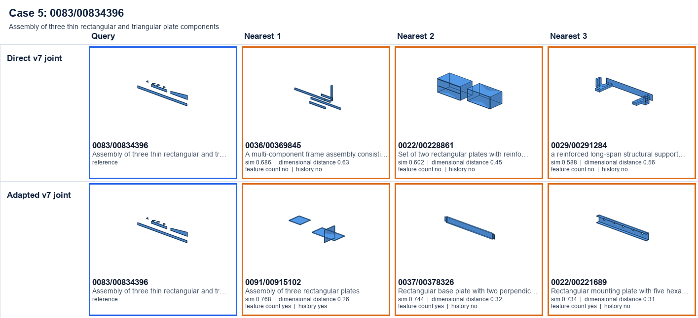
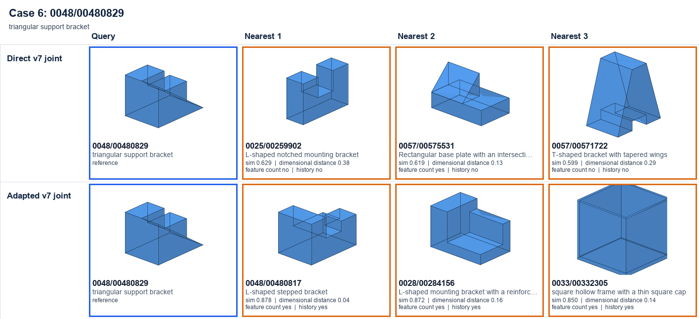

# Direct versus adapted v7 retrieval

Blue is the query. Green indicates a canonical functional-label match; orange indicates a mismatch. Functional labels were not used to train the adapter. Each result also reports standardized dimensional distance, feature-count agreement, and exact history agreement.

## Case 1

## Case 2

## Case 3

## Case 4

## Case 5

## Case 6

